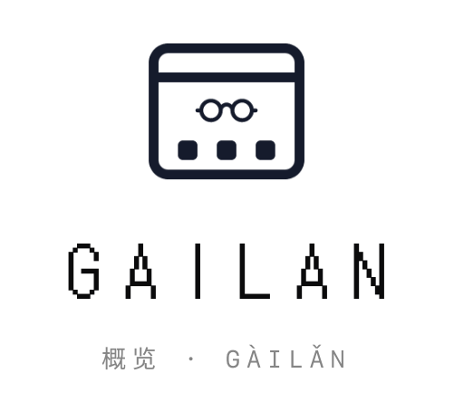

<h1 align="center">
  <picture>
    <source
      srcset="Gailan/gailan-brand-dark.png"
      media="(prefers-color-scheme: dark)"
    />
    
  </picture>
</h1>

<p align="center"><em>Watch what's happening on your machine and in the world.</em></p>

**Gailan** (概览, Gàilǎn) is the Mandarin Chinese translation of the German Übersicht ("Overview").

Read it in Cantonese and you get 芥蘭 🥦, Chinese broccoli. That wasn't the plan, but
it's a fine vegetable and I'm not fighting it.

Gailan is a fork of [felixhageloh/uebersicht](https://github.com/felixhageloh/uebersicht). See the [Übersicht website](http://tracesof.net/uebersicht).

## Widgets

Start with these three widgets from [GailanHub](https://github.com/nich227/GailanHub). Each widget is a folder of readable files. Download its zip from the
[gallery](https://gailanapp.pages.dev/hub).

<table>
  <tr>
    <td width="33%">
      <a href="https://github.com/nich227/GailanHub/tree/main/widgets/clock">
        
      </a>
    </td>
    <td width="33%">
      <a href="https://github.com/nich227/GailanHub/tree/main/widgets/system">
        
      </a>
    </td>
    <td width="33%">
      <a href="https://github.com/nich227/GailanHub/tree/main/widgets/nowplaying">
        
      </a>
    </td>
  </tr>
  <tr>
    <td><strong>Clock</strong><br />The time on a dot matrix or hands on a dial.</td>
    <td><strong>System Monitor</strong><br />Memory, processor, disk, or network usage on a scale with a readable value.</td>
    <td><strong>Now Playing</strong><br />The track, its cover, and working controls.
    Needs Spotify or the Music app.</td>
  </tr>
</table>

## Differences from Übersicht

Gailan is a separate application, not an in-place or backward-compatible Übersicht upgrade. It
has its own name, bundle ID, and support directory, so it installs beside Übersicht.
Übersicht's updater will never offer Gailan, but widget code carries over because the widget API is
the same. Settings and the widgets folder do not carry over, so you must move them by hand. Gailan
also upgrades bundled Node from 16 to 24. Rebuild widgets if their commands depend on old Node
behavior or include native modules built for Node 16. Upstream breaking changes: Node
[18](https://github.com/nodejs/node/blob/main/doc/changelogs/CHANGELOG_V18.md),
[20](https://github.com/nodejs/node/blob/main/doc/changelogs/CHANGELOG_V20.md),
[22](https://github.com/nodejs/node/blob/main/doc/changelogs/CHANGELOG_V22.md),
[24](https://github.com/nodejs/node/blob/main/doc/changelogs/CHANGELOG_V24.md),
[React 19](https://react.dev/blog/2024/04/25/react-19-upgrade-guide),
[CoffeeScript 2](https://coffeescript.org/#breaking-changes),
[Emotion 11](https://emotion.sh/docs/emotion-11),
[ws 8](https://github.com/websockets/ws/releases/tag/8.0.0)

The specifics:

  - Bundle ID: `com.kevster.Gailan` (AppleScript needs the new ID)
  - Widgets live in `~/Library/Application Support/Gailan/widgets`
  - Import the widget API module as `gailan`; `uebersicht` still resolves, so existing
    widgets keep working
  - The container element is `#gailan`. User CSS that targets `#uebersicht` no longer matches, so update it
  - Widget commands use zsh by default. Preferences lets you select
    fish instead. Übersicht used bash. Plain POSIX commands work the same in both,
    but bash-specific syntax may need changes
  - Preferences also has a System, Light, or Dark appearance override. Widgets read it
    through `prefers-color-scheme`
  - If Übersicht is running when Gailan starts, a dialog offers to quit either app.
    Gailan is an upgraded Übersicht, so running both apps renders every widget twice
  - esbuild bundles widgets instead of browserify. `.jsx`, `.tsx` and
    classic object-literal widgets still work. Widget bundles now publish themselves
    to `globalThis.__gailanWidgets` instead of registering with browserify's require
  - A widget can ask macOS to apply a glass effect to the desktop behind it. See
    [Glass over the desktop](#glass-over-the-desktop)
  - Widgets… in the menu opens a window with a card for every installed widget.
    Each card shows its switch, screens, and declared settings. See
    [Widget settings](#widget-settings)
  - A widget can declare its own settings. The app creates controls and saves the
    values beside the widget
  - Widget IDs no longer include the file extension: `Clock.jsx` is `Clock`, not
    `Clock-jsx`, and a widget in its own folder uses the folder name. Update anything that refers
    to a widget by ID, including AppleScript
  - Gailan enables Opens at login the first time it runs because widgets are not
    visible until the app starts. You can disable it in Preferences, and Gailan
    remembers the setting
  - Open Widgets Hub in the menu opens the
    [widget gallery](https://gailanapp.pages.dev/hub), where each widget in
    [GailanHub](https://github.com/nich227/GailanHub) downloads as a zip. Übersicht widgets still work, so you can also use that gallery
    too
  - Check for Widget Updates compares the version in each widget's `widget.json`
    with the GailanHub version and lists outdated widgets. Each widget has a checkbox,
    so you can choose which updates to install. The check also runs once a day and
    opens nothing when no updates are available. Saved settings survive an update
    because Gailan replaces only files shipped by the hub
  - Gailan requires macOS 13.5 or later because the bundled Node runtime and system APIs
    need it. The app does not launch on older versions

Gailan uses Node 24, the current LTS. Git no longer stores the Node runtime. See [Building Gailan](#building-gailan).

### Dependency versions

Compared with Übersicht 1.6.82, the latest release when Gailan was forked:

| | Übersicht | Gailan |
|---|---|---|
| bundled Node | 16.1.0 | 24.20.0 |
| minimum macOS | 10.11 (Podfile), 12.0 (target) | 13.5 |
| React | 16.13 | 19.2 |
| CoffeeScript | `coffee-script` 1.12 for widgets and the server | removed, and the server uses TypeScript |
| Emotion | 10 (`emotion`, `@emotion/core`) | 11 (`@emotion/css`, `@emotion/react`) |
| widget bundler | browserify 16.5 | esbuild 0.25 |
| browserify | 16.5 | 17.0, client and server bundles only |
| ws | 6.0 | 8.21 |
| redux | 3.7 | 5.0 |
| superagent | 3.8 | 10.3 |
| esprima / escodegen | 2.7 / 1.14 | 4.0 / 2.1 |
| minifier | uglify-js 3.10 | terser 5.51 |
| stylus | 0.54 | 0.64 |
| tape | 4.13 | 5.10 |
| through2 | 2.0 | replaced by Node streams |
| jQuery | 3.5 | 3.7, deliberately not 4.x |
| Sparkle API | `SUUpdater` (Sparkle 1, deprecated) | `SPUStandardUpdaterController` |

jQuery remains on 3.x because 4.0 removes APIs used by classic widgets.
All other dependencies use the current release in their version line.

## Migrating from Übersicht

Copy your widgets to Gailan, and they will run. Gailan uses the same widget API, so
most widget files need no changes.

    cp -R ~/Library/Application\ Support/Übersicht/widgets/* \
          ~/Library/Application\ Support/Gailan/widgets/

Übersicht's directory name contains a `ü`, which macOS may store in precomposed or decomposed form. If the shell cannot find
that path, use tab completion or copy the folder in Finder.

Settings do not transfer. Gailan stores each widget's screen, hidden state, and
background placement in its own preferences. Set them again from the status bar menu.
Gailan Preferences shows the widgets folder location, shell, and login item.

Both apps can run together, but each renders every widget. Quit Übersicht first.
Gailan offers to quit Übersicht when it starts.

### Changes a widget might need

  - `import {...} from "uebersicht"` still works. Gailan exposes the same module under both names, so no rewrite is
    needed. However, `"gailan"` is the name to use.
  - CSS that targets `#uebersicht` no longer works. The container element is `#gailan`. This is the change a widget most likely needs. It applies to `main.css` in the widgets folder and to widget styles.
  - AppleScript references to `application id "tracesOf.Uebersicht"` need
    `"com.kevster.Gailan"`.
  - bash-specific command syntax may need changes. You can also change the shell in
    Preferences. Gailan uses zsh by default, while Übersicht used bash.
    Plain POSIX commands behave the same in both.
  - Rebuild native modules bundled inside a widget against Node 24.
  - Review widget commands that depend on old Node behavior. See the
    breaking changes linked above.

The remaining widget features are unchanged: `command`, `refreshFrequency`, `render`,
`updateState`, `className`, classic object-literal widgets, `window.$`, and the
`/run/` proxy.

## Writing widgets

Widgets are TypeScript (or JavaScript) modules that expose properties and methods. Define each widget in one file with a `.tsx` (or `.jsx`) extension so Gailan can find it. Bundling removes type annotations but does not type-check the code. Gailan does not support CoffeeScript widgets. Übersicht's classic API still works, but the file must be `.js`. See [the old documentation](ClassicWidgets.md) for that API. Gailan watches the widget directory for file changes, so edits appear live.

Gailan renders widgets with [React](https://react.dev) and [JSX](https://react.dev/learn/writing-markup-with-jsx) syntax. Gailan manages simple widget state. Advanced widgets can use a Redux-like pattern to manage state. You `dispatch` events. A single `updateState` function processes each event and returns the new state. Gailan passes this state to the widget's render function.

Gailan keeps state when you modify a widget, so UI changes appear immediately during live coding. The current implementation might require you to select 'Refresh all Widgets' from the app menu after changing the state shape.

Widgets can include Node modules. You can split a widget into separate files with [ESM syntax](http://2ality.com/2014/09/es6-modules-final.html). Files in a directory named `/node_modules`, `/lib` or `/src` are modules and do not appear as separate widgets.

Widgets support these properties and methods:

### command

A string containing a shell command to execute, or<br>
a function(dispatch: function) that eventually dispatches an event,
or undefined when the widget has no command.

For example:

```tsx
export const command = "echo Hello World";
```

Quotes inside commands often need escaping, as shown here:

```tsx
export const command = "ps axo \"rss,pid,ucomm\" | sort -nr | head -n3";
```

Command function example:

```tsx
export const command = (dispatch) =>
  fetch('some/url.json')
    .then((response) => {
      dispatch({ type: 'FETCH_SUCCEEDED', data: response.json() });
    })
    .catch((error) => {
      dispatch({ type: 'FETCH_FAILED', error: error });
    });
```

A command function receives one argument, a `dispatch` function. Use it to dispatch plain JavaScript objects called events to your `updateState` function.


### refreshFrequency

A number that sets the delay, in milliseconds, between command executions. Example:

```tsx
export const refreshFrequency = 1000; // widget will run command once a second
```

The default is 1000 milliseconds (1 second). Setting the value to `false` disables automatic refresh.

### className

An object or string that defines the CSS rules for the widget's root.

This property usually controls the widget's position. The [Emotion CSS-in-JS library](https://emotion.sh/docs/css) converts the value to a CSS class name. Read more about [styling your widgets](#styling-widgets).

```tsx
export const className = {
  top: 0,
  left: 0,
  color: '#fff'
}
```

or

```tsx
export const className = `
  top: 0;
  left: 0;
  color: #fff;
`
```

Widgets use absolute positioning relative to the screen (excluding the menu bar). Thus, a widget with `top: 0` and `left: 0` appears at the screen's top left, just below the menu bar.

### render : props

A function(props: object) that renders your widget.

If you know [React functional components](https://react.dev/learn/your-first-component), this render function works the same way. Gailan passes `props` to this function. They contain the state returned by your `updateState` function. If you do not provide an `updateState` function, Gailan passes the default properties `output` and `error`. These properties contain the command output and any error that might have occurred.

```tsx
export const render = ({output, error}) => {
  return error ? (
    <div>Something went wrong: <strong>{String(error)}</strong></div>
  ) : (
    <div>
      <h1>We got some output!</h1>
      <p>{output}</p>
    </div>
  );
}
```

The default render function returns `output`.

### Widget settings

A widget can declare its settings in the `widget.json` beside the widget. Gailan creates each setting's control in the Widgets window and saves the selected values. Gailan passes the values to `render` as `props.settings`.

```json
{
  "title": "Clock",
  "settings": [
    {
      "key": "size",
      "type": "choice",
      "label": "Size",
      "default": "medium",
      "options": [
        {"value": "small", "label": "Small"},
        {"value": "medium", "label": "Medium"},
        {"value": "large", "label": "Large"}
      ]
    },
    {
      "key": "accent",
      "type": "list",
      "label": "Accent",
      "default": "red",
      "options": [
        {"value": "red", "label": "Red"},
        {"value": "amber", "label": "Amber"},
        {"value": "green", "label": "Green"}
      ]
    },
    {"key": "showSeconds", "type": "toggle", "label": "Show seconds", "default": true},
    {"key": "opacity", "type": "number", "label": "Opacity", "default": 42, "min": 10, "max": 90}
  ]
}
```

```tsx
export const render = ({output, settings = {}}) => (
  <div style={{opacity: (settings.opacity ?? 42) / 100}}>
    {settings.size === "large" ? <big>{output}</big> : output}
  </div>
)
```

Each type uses one control:

| type | control | extras |
|---|---|---|
| `choice` | segmented picker | `options`, as strings or `{value, label}` |
| `list` | menu | `options`, the same as `choice` |
| `toggle` | switch | |
| `number` | slider with its value | `min`, `max`, `step` |
| `text` | text field | |
| `color` | color well with opacity | stored as `#rrggbbaa` |

`choice` and `list` use the same values and differ only in the control. Use segments for two or three short options and a menu for more.

Every setting needs a `key` and a `type`. `label`, `help` and `default` are optional, but set a `default` because the control shows it before the user makes a selection.

A setting can also specify when it applies. `enabledWhen` names the other settings and values that enable this setting. The control stays visible but is gray when disabled.

```json
{
  "key": "hours",
  "type": "choice",
  "label": "Hours",
  "default": "12",
  "options": ["12", "24"],
  "enabledWhen": {"face": "digital"}
}
```

The clock uses this condition. The 12 or 24 hour setting does not apply to a dial, so the control is gray when the face is analog. A key can accept several values (`{"face": ["digital",
"dots"]}`), and every named key must match. Values are compared
as text, so `true` and `82` match without quotes. A condition that names an undeclared setting is ignored, so a typo leaves the control usable instead of stuck.

`title` sets the name shown in the Widgets window. It is separate from the settings and falls back to the widget id.

### Dependencies

A widget can declare its machine dependencies. Gailan checks each dependency when the widget loads. If any are missing, Gailan blurs the widget and displays the missing dependencies over it. The widget command still runs and can do work that does not need the missing dependency.

```json
{
  "title": "Media Stats",
  "dependencies": [
    {"type": "command", "name": "ffmpeg", "hint": "brew install ffmpeg"},
    {"type": "python", "name": "requests", "hint": "pip3 install requests"},
    {"type": "node", "name": "chalk"},
    {"type": "brew", "name": "imagemagick"},
    {"type": "shell", "name": "docker running", "test": "docker info"}
  ]
}
```

| type | what it checks |
|---|---|
| `command` | found on `PATH`, using `command -v` |
| `node` | resolvable from the widget's own `node_modules` or another location that Node checks |
| `python` | importable by `python3` |
| `ruby` | can be required by `ruby` |
| `brew` | installed under brew's prefix |
| `shell` | `test` reports the result. A zero exit code means present |

`name` appears in the message. `hint` is optional. `test` applies only to
`shell` entries. Gailan ignores entries without a usable type and name.

If the interpreter is absent, the message names it instead of the package. A widget that requests a Python module on a Mac without `python3` shows
`python3` in the list.

The app caches results while it runs and shares them between widgets. Thus, ten widgets that name `ffmpeg` require one check. Refreshing a widget repeats the check, so refresh it after installing something.

The app writes your choices to `settings.json` in the widget's folder, so the settings travel with the widget. The widget looks the same after you copy its folder to another Mac. Saving this file does not trigger a rebuild because it is not a widget. You can edit the file by hand. The widget reads it when it loads.

The adjacent `settings.default.json` stores each setting's fallback. Gailan creates it when it first sees the widget and uses the `default` from each manifest entry. Gailan then leaves the file unchanged, so your edits remain. A setting in this file replaces the manifest default. Thus, you can change a widget's fallback without editing the widget. Reset to Defaults in the settings sheet restores each setting to this file's value.

Use a separate folder for each widget:

```
~/Library/Application Support/Gailan/widgets/
  clock/
    index.tsx              the widget, and the id becomes "clock"
    widget.json            title and settings
    settings.json          what you chose, written by Gailan
    settings.default.json  what it falls back to, written once and yours to edit
    preview.jpg            shown on the card in the Widgets window
```

### updateState : event, previousState

A function(event: object, previousState: object) updates the widget state.

If you provide this function, it must return the next state. The render function receives this state as `props` when it runs. By default, the updateState function returns `output` and `error` from the event object.

```tsx
export const updateState = (event, previousState) => {
  if (event.error) {
    return { ...previousState, warning: `We got an error: ${event.error}` };
  }
  const [cpuPct, processName] = event.output.split(',');
  return {
    cpuPct: parseFloat(cpuPct),
    processName
  };
}
```
The example passes a props object with `cpuPct` and `processName` to the render function. If an error occurs, the example passes the previous state with a warning message.

For more complex state logic, such as fetching data from several sources, add a `type` property to your events. Use its value to select how to update the state. For example:

```tsx
export const updateState = (event, previousState) => {
  switch(event.type) {
    case 'CO2_FETCHED': return updateCo2(event.output, previousState);
    case 'TEMPERATURE_FETCHED': return updateTemp(event.output, previousState);
    default: {
      return previousState;
    }
  }
}
```

The example separates each state update into a function.

### initialState

This object contains the widget's initial state.

If you provide a custom `updateState` function, you might need to define the widget state before its first render, which occurs before any command runs.

```tsx
export const initialState = { output: 'fetching data...' };
```

The default initial state is `{ output: '' }`.

### init : dispatch

The init function takes a dispatch function and runs when the widget first loads. Many widgets do not need it. Use it for initial setup, such as opening a WebSocket to listen for events instead of periodically running shell commands.

```tsx
export const init = (dispatch) => {
  const socket = new WebSocket('ws://localhost:8080');

  socket.addEventListener('message',  (event) => {
    dispatch({type: 'MESSAGE_RECEIVED', data: event.data});
  });
}
```

## Styling widgets

Gailan includes [Emotion](https://emotion.sh) (version 11). Gailan exposes Emotion's `css` and `styled` functions through the `gailan` module. It also provides
`run`, `request` (superagent), and `React`.

Use `className` to style and position the widget's root node. For other elements, use this pattern:

```tsx
import { css } from "gailan"

const header = css`
  font-family: Ubuntu;
  font-size: 20px;
  text-align: center;
  color: white;
`

const boxes = css`
  display: flex;
  justify-content: center;
`

const box = css({
  height: "40px",
  width: "40px",
  "& + &": {
    marginLeft: "5px"
  }
})

export const className = `
  left: 20px;
  top: 20px;
  width: 200px;
`

export const initialState = { colors: ["DeepPink", "DeepSkyBlue", "Coral"] }

export const render = ({ colors }) => {
  return (
    <div>
      <h1 className={header}>Some colored boxes</h1>
      <div className={boxes}>
        {colors.map((color, idx) => (
          <div className={`${box} ${css({ background: color })}`} key={idx} />
        ))}
      </div>
    </div>
  )
}
```

You can also use Emotion's styled components:

```tsx
import { styled } from "gailan"

const Header = styled("h1")`
  font-family: Ubuntu;
  font-size: 20px;
  text-align: center;
  color: white;
`

const Boxes = styled("div")`
  display: flex;
  justify-content: center;
`

const Box = styled("div")(props => ({
  height: "40px",
  width: "40px",
  background: props.color,
  marginRight: "5px"
}))

export const className = `
  left: 20px;
  top: 20px;
  width: 200px;
`

export const initialState = { colors: ["DeepPink", "DeepSkyBlue", "Coral"] }

export const render = ({ colors }) => {
  return (
    <div>
      <Header>Some colored boxes</Header>
      <Boxes>
        {colors.map((color, idx) => (
          <Box color={color} key={idx} />
        ))}
      </Boxes>
    </div>
  )
}
```

You can install and import another styling library instead.

### Light and dark

Preferences offers a System, Light, or Dark appearance setting. Widgets read the selected setting in two
ways: the standard `prefers-color-scheme` media query and the `data-appearance` attribute
on the root element. The attribute is often easier to nest in a styled component:

```tsx
export const className = `
  color: #1f1f28;

  html[data-appearance="dark"] & {
    color: #e6e6ec;
  }
`
```

Both follow Gailan's setting, not the system setting. Choosing Dark while macOS uses
Light mode gives widgets dark styling.

### Liquid Glass

macOS draws the glass. A widget marks the target area, and macOS frosts the
wallpaper behind it. CSS cannot access content behind its own window. The app draws the glass because
the window server composites the transparent web view over the desktop. `backdrop-filter` only sees other page content.

```tsx
export const render = ({output}) => (
  <div data-gailan-desktop-glass={12} style={{borderRadius: 12, padding: 20}}>
    {output}
  </div>
)
```

`DesktopGlass` from the `gailan` module provides the same behavior through a component.
Give the element an `id` and the app moves the glass with the element when the widget renders again.

Keep the widget's background thin, or it covers the glass. The starter
widget uses about 40% opacity, which keeps the text legible while showing the frost.

The app draws the glass under the web view, where the page cannot detect it. The app reports the state through a `data-desktop-glass`
attribute on the root element. Its value is `on` or `off`. Widgets that use a thin background
for frost should also work without it. Otherwise, they look washed out over a plain
wallpaper:

```tsx
export const className = `
  background: rgba(11, 11, 12, var(--fill, 0.82));

  html[data-desktop-glass="off"] & {
    --fill: 1;
  }
`
```

All bundled widgets do this. The value follows the setting, not the system. Thus, it reads
`off` on macOS 26 when the user switches off the effect. It reports the same value on older systems when frost is off.

Preferences includes the macOS controls. `Liquid Glass` controls whether the effect is active. It is on by default. On macOS 26 and later, Preferences also includes `Style` and
`Opacity`.

Before macOS 26, the system uses AppKit's vibrancy material. The control
appears under Appearance as `Frost
Effect`, with the same on/off state and opacity. Users cannot set the amount of frost. AppKit's lighter and heavier materials look the same over a wallpaper
under the widget's background. AppKit selects the amount because it does not expose a blur radius.

There is no tint color setting. The tint comes from the current wallpaper and changes with it. Each display
resolves its own tint because a Mac can show a different wallpaper on each display. If macOS reduces window background tinting through the `Tint window background with wallpaper color`
setting, Gailan also leaves the glass untinted.

`Style` is `Follow system` by default. This option reads the Liquid Glass setting under System
Settings, Appearance. Thus, desktop glass matches glass elsewhere. macOS 26.1 added that setting with two options, `Clear` and `Tinted`,
and Gailan offers both and an option that follows the system. AppKit does not expose this setting, so Gailan
reads the value from `NSGlassDiffusionSetting`. A value of 0 selects Clear, and 1 selects Tinted. If the value is
absent, Gailan uses Clear. This matches the macOS default and the behavior on all systems before 26.1.
Changes take effect when the user makes them. System Settings writes the value from another
process, but AppKit does not announce changes. Thus, Gailan watches the value. The other two
options ignore system changes. `Clear` uses glass without tint, and `Tinted` uses glass tinted with the wallpaper color.

`Opacity` adds a solid surface over the glass. Thus, Gailan looks the same whether it is frontmost or not. macOS draws Liquid Glass differently for the frontmost app, and this cannot be disabled. When the setting adjusted the glass itself, it also changed the visibility of this difference. At full strength, Gailan looked like glass when frontmost and like a slab otherwise. Thinning the glass removed the refraction that the setting was meant to adjust. The surface fixes both cases. Full opacity covers the glass, so both states have the same solid color. Low opacity leaves the glass fully drawn, so the states look nearly the same. It defaults to 10%
with `Clear`, a subtle style that needs almost no surface, and 82% with `Tinted`,
which already carries the wallpaper color. The minimum is 10%, not zero.

Before macOS 26, the setting controls the frost view's alpha because `NSVisualEffectView` can
be configured to keep its active appearance regardless of the app's state. Thus, both states look
the same.

## Running shell commands

To run extra shell commands without the [command](#command) property, import the `run` function from the `gailan` module.

The function returns a Promise that resolves with the command's stdout and rejects if an error occurs.

```tsx
import { run } from 'gailan'

export const render = (props, dispatch) => {
  return (
    <button
      onClick={() => {
        run('echo "new output"')
          .then((output) => dispatch({type: 'OUTPUT_UPDATED', output}))
      }}
    >
      Update
    </button>
  );
}
```
> Note: To receive click events, configure an interaction shortcut and give Gailan accessibility access.

## Geolocation API

`navigator.geolocation`, the standard browser API, does not work in a widget because a
`WKWebView` hosted in an app cannot prompt for location. Thus, the API exists but never returns a position. Gailan asks macOS for the location and gives it to widgets through `window.geolocation`, which matches the standard
API as closely as possible. It supports these basic methods:

```js
geolocation.getCurrentPosition(callback)
```

```js
geolocation.watchPosition(callback)
```

```js
geolocation.clearWatch(watchId)
```

See the [documentation](https://developer.mozilla.org/en-US/docs/Web/API/Geolocation) for details. These methods do not accept options. Gailan always uses the highest position accuracy. Gailan does not report errors yet.

In addition to the standard `Position` object, Gailan adds an `address` property with these fields:

  - Street
  - City
  - ZIP
  - Country
  - State
  - CountryCode


## Built-in proxy server

A widget is served from `http://127.0.0.1:41416`, so all other fetches are cross-origin requests that the destination must allow. Most websites do not allow them,
so the proxy handles them. The proxy listens on the port after the widget server,
`http://127.0.0.1:41417`, and the destination address follows the slash:

```tsx
export const command = async (dispatch) => {
  const proxy = "http://127.0.0.1:41417/";
  const answer = await fetch(proxy + "https://example.com:8080/getsomejson");
  dispatch({ type: "GOT_JSON", payload: await answer.json() });
};
```

`http` is the default if you omit the scheme. The proxy rejects anything else, including `file:` or `data:`,
instead of reading it as a hostname.

The proxy responds only to requests from the widget page's origin. Another website can reach your loopback interface through the browser. However, the browser sets `Origin`, so another website cannot claim to be a widget. The proxy strips cookies from requests and responses. It follows redirects and checks each hop as a direct request. It refuses link-local addresses because a machine's metadata service uses them. Your local network remains reachable, so a widget can read a router page or NAS.

Übersicht used [cors-anywhere](https://github.com/Rob--W/cors-anywhere) here. The project is unmaintained, and every published version has an advisory. Thus, Gailan implements the proxy itself.

## Shortcuts and Siri

Gailan provides ten actions to the Shortcuts app. Actions that target one widget show a picker of the widgets on your desktop. Thus, you select a widget by name instead of typing its ID.

| Action | What it does |
|---|---|
| Refresh Widget | Runs the widget's command again |
| Refresh All Widgets | Runs every widget's command again |
| Reload Widget | Rebuilds it from its file after you change it |
| Show or Hide Widget | Hides one without deleting it |
| Set Widget Layer | Places it behind or in front of your windows |
| Choose Widget Screens | Uses the main screen or every screen |
| Change Widget Setting | Sets one of the widget's settings by key |
| Open Widget File | Opens it in your editor |
| Keep Widgets in Front | Chooses whether every widget stays above your other windows |
| Set Widget Appearance | Uses light, dark, or the system setting |

`Change Widget Setting` accepts the value as text because Shortcuts cannot know
what each key expects. `true`, `yes` and `on` become booleans. Their opposites also become booleans. Values that parse as numbers become numbers. Gailan leaves every other value
unchanged. The key is the name defined in the widget's `widget.json`.

Siri responds to "refresh Gailan widgets" without setup. The other actions appear in
Spotlight after Gailan runs.

## Scripting support

Gailan supports AppleScript. To see available commands, open Script Editor. Select Window > Library to display the Library, then add Gailan. These examples use the application ID instead of the app name:

    tell application id "com.kevster.Gailan" to refresh

Refreshes all widgets.

    tell application id "com.kevster.Gailan" to refresh widget id "my-widget"

Refreshes the widget with ID "my-widget".

    tell application id "com.kevster.Gailan" to every widget

Lists all widgets.

    tell application id "com.kevster.Gailan" to set hidden of widget id "top-cpu-js" to false

Shows the widget with ID "top-cpu-js".


## Building Gailan

To build Gailan, install Node.js and the server's dependencies:

### Setup

Gailan's server requires Node 24, which the app bundles. Build with Node 24:

```
brew install node@24
```

Or `nvm install 24`. Then install the dependencies:

```
cd server && npm install
```

### the bundled Node runtime

The `node` binaries bundled in `Gailan.app` are not checked into Git because one Darwin build is around 145 MB, above GitHub's 100 MB file limit. `scripts/fetch-node.sh`
downloads the binaries, verifies them against the SHA256 sums published by the Node.js project, and
places them in `server/release/`:

```
./scripts/fetch-node.sh
```

`npm run release` runs the script for you. Xcode builds do the same. To use a newer Node version,
change `NODE_VERSION` and the two checksums at the top of the script.

### Building

The codebase contains a Cocoa app and a Node.js app in `server/`. Build the Node.js app separately with `npm run release`. Xcode runs this command during every build.

Run the Node.js app separately with:

```
cd server && node server.ts -d <path/to/widget/dir> -p <port>
```

`-s` specifies a settings directory, and `--login-shell` runs widget commands in a login shell. `npm start` runs the server with the default settings.

# Building in Xcode

When you first open the project, Xcode might show this build message: "The run destination My Mac is not valid for Running the scheme 'Gailan'."

Select `Gailan` in the project navigator. Select `Editor > Validate Settings...` and click `Perform Changes`.

Build the project again. If Xcode reports code signing issues, click `Fix Issue` to continue.

Remove the code signing shell script. Select the `Gailan` target. Under `Build Phases`, empty out the phase named `Run Script`.

The project should now build. The app needs no extra configuration to communicate with its own
server over HTTP because `NSAllowsArbitraryLoads` is already configured in `Gailan-Info.plist`.

# Legal

Gailan is a fork of [Übersicht](https://github.com/felixhageloh/uebersicht) by Felix Hageloh.

The source is released under the GNU General Public License as published by the Free Software Foundation, either version 3 of the License, or (at your option) any later version.

© 2026 Kevin Chen. Based on Übersicht, © 2019 Felix Hageloh.

The app icon, menu bar icon, and wordmark use the window-dock and eyeglasses
icons from [Bootstrap Icons](https://github.com/twbs/icons), © 2019-2024 The Bootstrap Authors,
[MIT licensed](licenses/bootstrap-icons.txt).

## Third-party assets

The starter widget renders the Gailan name in [DotGothic16](https://github.com/fontworks-fonts/DotGothic16), which the website also uses. The app ships a 2 KB subset with only the letters in the
name instead of the full 2 MB font with Japanese coverage. It copies the subset beside
the widget, so the desktop never waits on the network to draw the word. The app uses the
font under the SIL Open Font License and includes the license in the app bundle as `gailan-wordmark-OFL.txt`.
